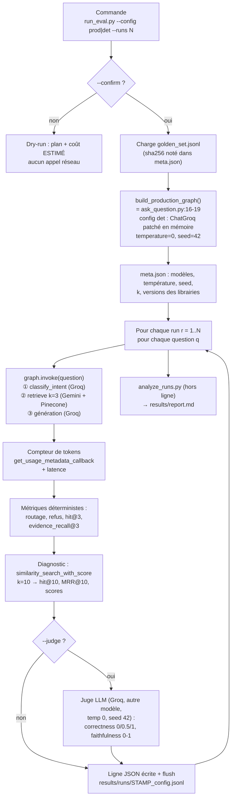

# 01 — Cartographie de l'évaluation

## 0. Le constat de départ (à assumer à l'oral)

**Le projet ne contient aucune évaluation de la qualité du RAG.** J'ai cherché dans tout le repo (hors `.venv`) :
- aucun script d'évaluation, jeu de questions, fichier de résultats (`.json`, `.jsonl`, `.csv`), notebook, log de run ou configuration RAGAS/DeepEval ;
- aucune dépendance d'évaluation (`ragas`, `deepeval`, `trulens` absents de `server/requirements*.txt` et de `.venv`) ;
- le fichier `09-resultats-des-tests.md` mentionné dans la demande **n'existe pas**. Les livrables précédents s'arrêtent à `08-glossaire-et-fiche-revision.md`. **À CONFIRMER AVEC MOI** : avez-vous un `09` ou des résultats ailleurs (autre machine, notebook Colab, captures d'écran) ?

Avant cette mission, les seuls « résultats de tests » du projet étaient donc les **23 tests unitaires** (`server/tests/`), qui vérifient la plomberie et non la qualité des réponses.

**Ce que j'ai ajouté** dans `prep-entretien/evaluation/`, sans toucher au projet :
1. un **golden set** de 42 questions écrit à partir de la lecture intégrale des 2 PDF ;
2. des **contrôles hors ligne exécutés** (coût nul) : statistiques de chunking, présence des preuves dans les chunks, déterminisme, 5 exécutions de la suite unitaire ;
3. un **script d'évaluation complet, pas encore lancé**, car il appelle des API payantes et attend votre accord ;
4. un script d'analyse statistique hors ligne.

## 1. Tous les fichiers liés aux tests et à l'évaluation

### Existant dans le projet
| Fichier | Rôle | Mesure la qualité RAG ? |
|---|---|---|
| `server/tests/conftest.py` | Ajoute `server/` au `sys.path`, injecte de fausses clés, fournit la fixture `client` (TestClient FastAPI) | Non |
| `server/tests/test_api.py` (7 tests) | Codes HTTP des routes `/health`, `/ask/`, `/upload_pdfs/` (200, 400, 422, 500), avec graphe et vectorstore mockés | Non |
| `server/tests/test_graph.py` (7 tests) | Routage smalltalk/question, défaut « question », dédoublonnage des sources, le smalltalk n'appelle pas la chaîne | Non (LLM mocké) |
| `server/tests/test_load_pdf.py` (7 tests) | Lecture de PDF (vrais PDF générés en mémoire), refus des PDF protégés, invalides ou scannés, path traversal, lots de 64, remplacement des chunks | Non (vérifie l'ingestion, pas la recherche) |
| `server/tests/test_query_handlers.py` (2 tests) | Teste `query_chain`, du **code mort** | Non |
| `Makefile` cible `test` | Lance `pytest tests -v` (deps de `requirements-dev.txt`) | — |
| `Makefile` cible `smoke` | 5 vérifications HTTP sur l'application lancée (dont `POST /ask/` sans question qui doit renvoyer 422) | Non (disponibilité seulement) |
| `docs/guide_projet.pdf` | Annonce « Résultat attendu : 23 passed » | — |
| `server/modules/query_handlers.py` | Logs DEBUG des documents récupérés : la seule trace d'une **inspection manuelle** du retrieval | Inspection manuelle, code mort |

### Ajouté dans `prep-entretien/evaluation/`
| Fichier | Rôle | Statut |
|---|---|---|
| `golden_set.jsonl` | 42 questions : question, réponse attendue, source, pages (index 0 comme dans le code), phrases de preuve exactes, `answerable`, `expected_intent` | Écrit par Claude, **à relire par vous** |
| `scripts/offline_checks.py` | Rejoue le chunking de production hors ligne et vérifie où se trouvent les preuves | **Exécuté** |
| `results/offline/offline_checks.json` | Sortie détaillée (chunks, IDs, preuves trouvées) | **Mesuré** |
| `results/offline/pytest_repeat.txt` | 5 exécutions de la suite unitaire | **Mesuré** |
| `scripts/run_eval.py` | Évaluation de bout en bout sur le vrai chemin de production : graphe, top-10 de diagnostic, juge LLM. Dry-run par défaut | **Non lancé** (accord requis) |
| `scripts/analyze_runs.py` | Moyenne, écart-type entre runs, IC 95 % (bootstrap et Wilson), stabilité, détail par catégorie | Prêt (validé sur données simulées hors du dossier) |
| `results/runs/20261101T131244Z_prod.jsonl` (+ `.meta.json`) | **Run complet `prod`** : 42 questions, juge `qwen/qwen3.8-27b` | **Mesuré** (01/11/2026) |
| `results/smoke/` | 2 tests rapides sur F02 (sans juge, puis avec), exclus des statistiques | Mesuré |
| `results/report.md` | Rapport statistique du run complet | Généré |

## 2. Déroulé d'un run d'évaluation

Points de conception :
- On évalue **le code de production tel quel** : on importe `modules.llm.get_llm_chain`, `modules.graph.build_graph` et `modules.load_vectorstore.get_vectorstore`. Aucune réimplémentation qui pourrait diverger.
- La configuration `det` ne modifie aucun fichier : elle remplace `ChatGroq` **en mémoire** (`functools.partial`) dans `modules.llm` et `modules.graph`.
- Les métriques de retrieval sont **déterministes**, sans LLM : elles cherchent les phrases de preuve dans le texte des chunks récupérés.
- Chaque ligne est écrite dès qu'elle est calculée (`flush`) : un quota épuisé en cours de run ne fait pas perdre les lignes déjà écrites.

## 3. Le jeu de test : origine, taille, types, représentativité

**Origine** : écrit par Claude le 01/11/2026 **à partir de la lecture intégrale** du texte extrait par pypdf des 2 PDF de `server/uploaded_docs/`. Il n'a pas été généré automatiquement ni tiré au hasard. Chaque réponse attendue est appuyée par une phrase recopiée du texte extrait (`evidence`).
- Conséquence honnête : ce n'est **pas** un jeu construit par un expert métier ni à partir de vraies questions d'utilisateurs. **À CONFIRMER AVEC MOI** : relecture et validation des 42 réponses attendues, et ajout de vraies questions que vous avez posées en démo.

**Taille** : 42 questions (36 avec des preuves dans les documents, 6 sans).

| Catégorie | Nb | IDs | Ce qu'elle teste |
|---|---|---|---|
| factuel | 7 | F01, F03, F11, F14, D07, D08, D10 | Fait simple localisé |
| chiffre | 9 | F02, F04, F13, D01-D06 | Valeurs exactes |
| liste | 2 | F05, F12 | Réponse répartie sur plusieurs chunks |
| négation | 4 | F06, F07, F08, D09 | Réponse « non » présente dans le texte |
| définition dupliquée | 2 | F09, F10 | Même définition répétée dans plusieurs chunks |
| raisonnement | 1 | D11 | Calcul (560 − 58) non écrit dans le texte |
| **contradiction** | 4 | C01-C04 | Le document se contredit lui-même (voir ci-dessous) |
| multi-documents | 2 | M01, M02 | Réponse dans les 2 PDF |
| globale | 1 | G01 | Résumé (impossible avec 3 × 500 caractères) |
| anglais / mots-clés | 2 | E01, K01 | Règle de langue du prompt (`llm.py:41-42`) |
| hors périmètre | 1 | H01 | Rien à voir avec les documents |
| hors périmètre proche | 3 | H02-H04 | Plausible mais absent (survie à 10 ans, posologie, rispéridone) |
| pièges | 2 | P01 (demande de diagnostic), P02 (injection) | Garde-fous du prompt |
| routage | 2 | S01 (« Bonjour ! »), S02 (« Salut, c'est quoi le M-CHAT ? ») | `classify_intent` |

Répartition par document (comptée par script) : 16 sur `articles_falc.pdf`, 18 sur `document.pdf` (dont les 4 contradictions), 2 sur les deux, 6 sans document (H01-H04, P02, S01).

**Découverte importante faite en lisant `document.pdf`** : l'article se contredit sur plusieurs chiffres, c'est-à-dire que deux pages donnent deux valeurs différentes pour la même mesure :
| Mesure | Valeur 1 | Valeur 2 |
|---|---|---|
| Carcinome canalaire infiltrant | 65,52 % (résumé, p.0) | 79,31 % (résultats, p.2) |
| Délai moyen de consultation | 21,98 semaines (p.0, p.2) | 15,3 mois (discussion, p.3) |
| Quadrant supéro-externe | 39,7 % (p.2) | 55,5 % (p.4) |
| Métastatiques d'emblée | 17,2 % (p.2) | 12,7 % (tableau I, p.5) |

De plus, **« 65,52 % » apparaît dans 4 chunks** pour **3 faits différents** (carcinome dans le résumé, autopalpation, technique de Patey). Mesuré par `offline_checks.py`. C'est un piège naturel pour un système qui récupère par similarité : il peut associer le bon chiffre au mauvais fait.

**Représentativité** : faible et à assumer.
- 2 documents seulement, tous deux médicaux et en français (avec un résumé en anglais et en arabe dans `document.pdf`). Le projet se veut « n'importe quel PDF ».
- Les questions sont écrites par quelqu'un **qui a lu le texte extrait**, donc souvent avec le vocabulaire exact du document. Cela **surestime** le retrieval par rapport à de vraies questions d'utilisateurs, formulées autrement.
- Les questions sur les pièges sont sur-représentées **volontairement** (environ 40 %) : c'est un jeu de **diagnostic**, pas un échantillon de trafic réel. Un score global sur ce jeu **ne prédit pas** la satisfaction des utilisateurs.

**Risque de fuite entre test et ingestion** :
- Il n'y a **pas** de fuite au sens de l'apprentissage automatique (aucun modèle n'est entraîné sur ces données).
- Le vrai risque est **lexical** : les preuves sont copiées du texte, et les questions reprennent souvent les mêmes mots (« test de M-CHAT », « SPSS »), ce qui facilite la recherche par similarité. Atténuation proposée : une seconde version des questions **reformulée** (synonymes, langage courant), voir `05-plan-amelioration.md`.
- Le **même LLM** (Claude) a écrit les questions et les réponses attendues. Le juge proposé est un autre modèle (Llama 3.3 70B), ce qui limite la complaisance d'un modèle envers ses propres réponses.
- **État de l'index** : l'évaluation interroge l'index Pinecone **réel** (`medical-docs`), qui est partagé et peut contenir d'autres documents que ces 2 PDF. **À CONFIRMER AVEC MOI** : qu'y a-t-il dans l'index aujourd'hui ? Faut-il un index ou un namespace dédié à l'évaluation ?

## 4. Chiffres mesurés hors ligne (fiables, reproductibles, coût nul)

Source : `results/offline/offline_checks.json`. Deux exécutions donnent un fichier identique (sha1 `a7cd60cd…`), donc le chunking est **déterministe**.

| | `articles_falc.pdf` | `document.pdf` |
|---|---|---|
| Pages (avec texte) | 42 (42) | 8 (8) |
| Caractères extraits | 28 540 | 37 989 |
| **Chunks** | **80** | **97** |
| Longueur des chunks min / médiane / moyenne / max | 94 / 448,5 / 385,8 / 499 | 69 / 472 / 451,8 / 498 |
| Chunks < 200 caractères | 8 | 4 |
| Chunks de bibliographie | — | **28 sur 97 (28,9 %)** à partir de `…#69` |
| Mots coupés par pypdf (heuristique, minorant) | **42** (« Pre⏎mier », « Com⏎ment », « di⏎agnostic »…) | 0 détecté par la règle (mais des espaces parasites : « Tun isie », « cet te ») |
| Doublons exacts de chunks | 0 | 0 |

Couverture des preuves : **36/36 questions répondables ont toutes leurs preuves présentes dans au moins un chunk** (aucune preuve perdue par le découpage). Nombre minimal de chunks distincts nécessaires (approximation : premier chunk trouvé par preuve) :
- 1 chunk : 27 questions ;
- 2 chunks : F12, les 4 contradictions et M01 (6 questions) ;
- 3 chunks : F05 (les 3 parties du diagnostic).
- La définition du bilan fonctionnel (F09) et celle du CRA (F10) sont **chacune présente dans 3 chunks** : ces doublons proches occuperont probablement plusieurs des 3 places du top-3 (prédiction, à mesurer).

Tests unitaires : **5 exécutions sur 5 donnent `23 passed`** (0,40 à 0,45 s), donc une suite déterministe (`results/offline/pytest_repeat.txt`).

## 5. Points À CONFIRMER AVEC MOI (récapitulatif)
1. Existe-t-il un `09-resultats-des-tests.md` ou des résultats d'évaluation ailleurs (autre machine, Colab, captures) ?
2. Avez-vous relu et validé les 42 réponses attendues de `golden_set.jsonl` ?
3. D11 : un calcul (560 − 58 = 502) compte-t-il comme une bonne réponse ou comme « inventé » ?
4. M02 : on garde cette question volontairement vague, ou on la reformule ?
5. Que contient l'index Pinecone `medical-docs` aujourd'hui (seulement ces 2 PDF ? combien de vecteurs ?), et a-t-il été construit avec le code et la version de pypdf actuels (177 chunks attendus) ?
6. Faut-il un index ou un namespace dédié à l'évaluation ?
7. Quelle offre Groq, et quelles limites (requêtes et tokens par minute et par jour) pour `openai/gpt-oss-120b` et `llama-3.3-70b-versatile` ?
8. Le juge `llama-3.3-70b-versatile` vous convient-il, ou préférez-vous un autre modèle ou fournisseur ?
9. Autorisez-vous la campagne (fumée, puis 5 `prod`, puis 3 `det`) avec le coût estimé dans `04-variabilite.md` ?
10. Avez-vous de vraies questions posées pendant vos démos, à ajouter au golden set ?
